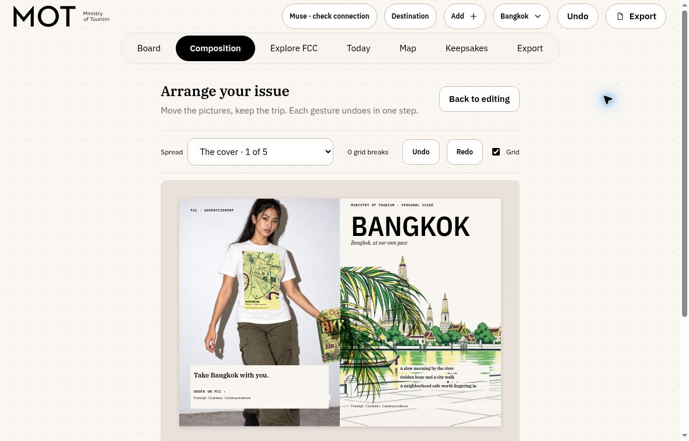
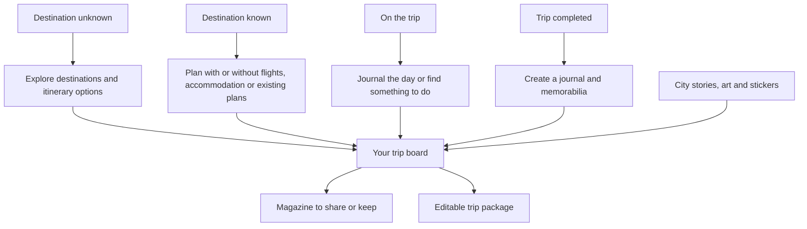
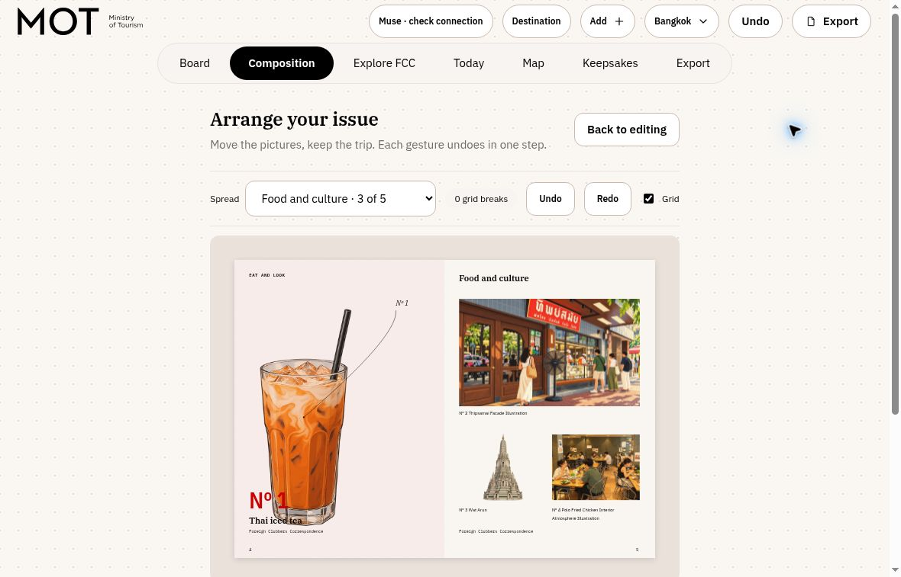
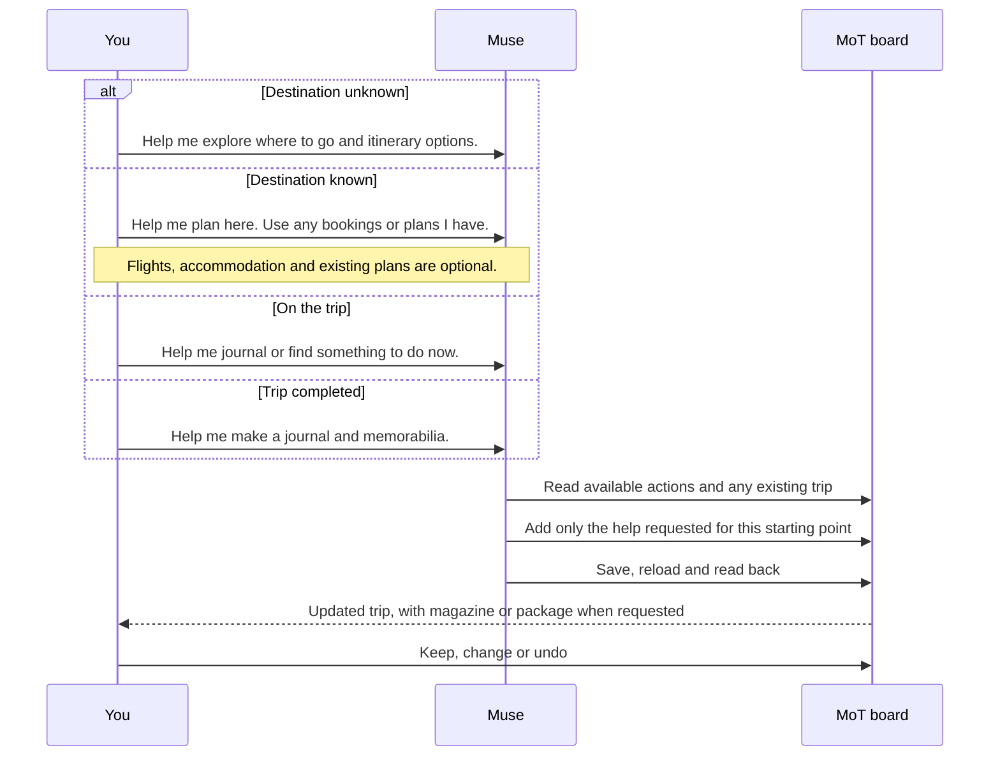
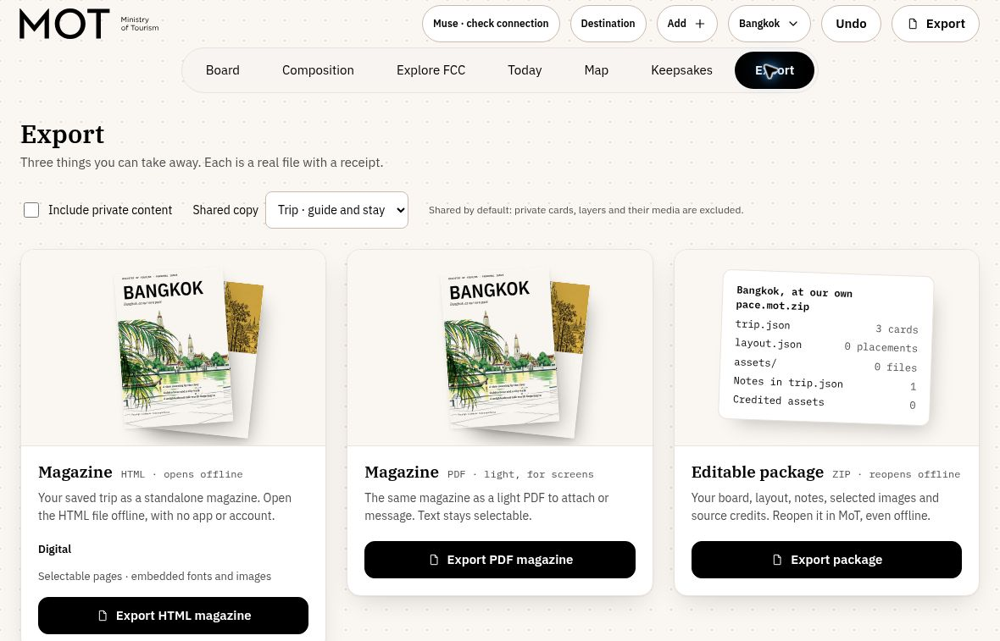
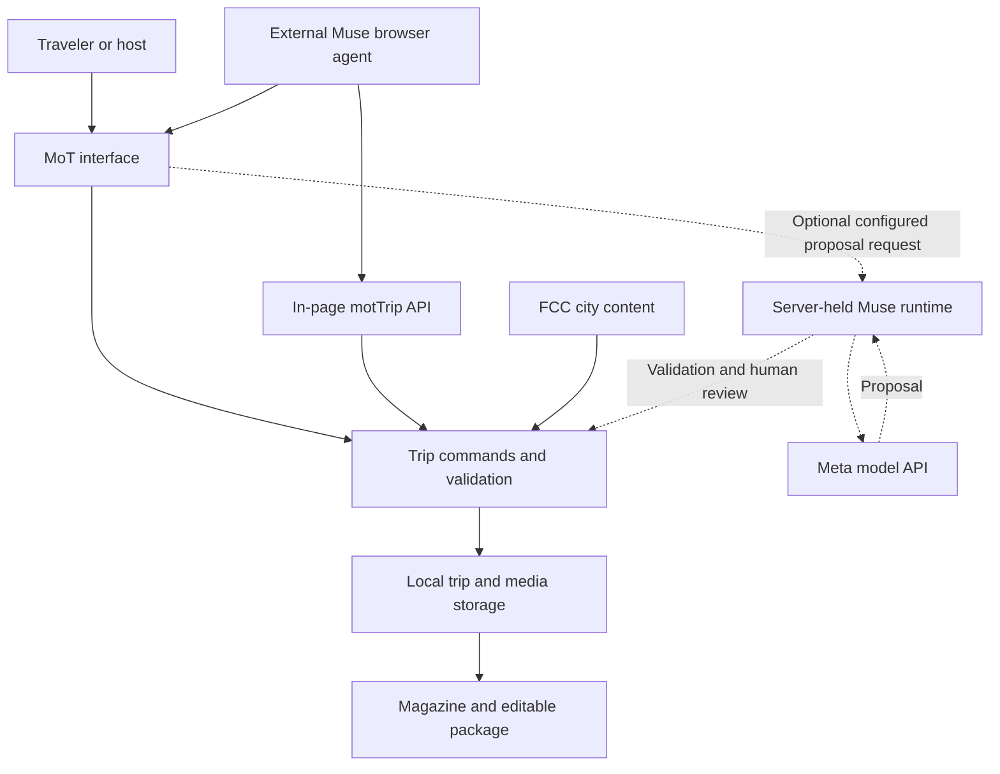
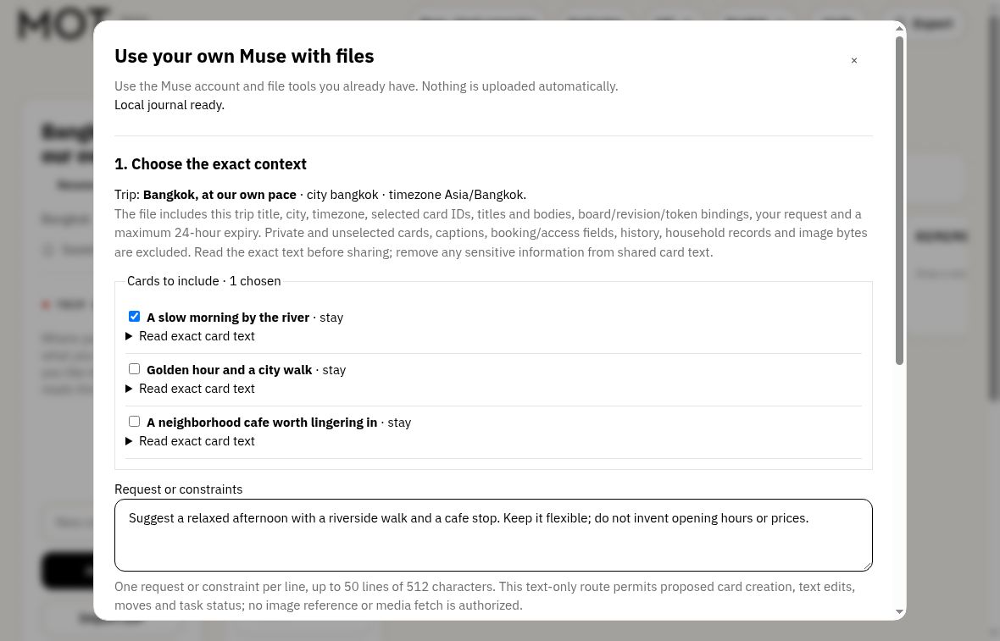

# Ministry of Tourism

## You're the Minister now.

Your flights are in an email. Your hotel is in a screenshot. Your places are scattered across maps, messages and things you meant to save.

**Ministry of Tourism turns those pieces into a trip you can shape, share and keep.**

**Built specifically for Muse AI, with a hands-on workspace for people who prefer to do it themselves.**

Bring your own Muse agent: its reasoning uses your Muse access and usage allowance. Firebase Hosting serves the web app; MoT handles the trip workspace, local data, FCC assets and magazine composition through ordinary application code. In this workflow, Muse does the thinking and MoT turns the result into something you can use.

A travel board for the solo traveler, the host making a guest guide, and the person somehow organizing the whole reunion. Bring your plans. Add a little local culture. Give Muse the admin. Keep the decisions yours.

**[Open Ministry of Tourism](https://ministryoftourism.web.app/?view=trip)** · [Guide for Muse](https://ministryoftourism.web.app/guides/trip-best-practices.md) · [Agent contract](https://ministryoftourism.web.app/trip-agents.md)

Start with the [owner's manual](OWNER-MANUAL.md) for practical steps, or explore the [use cases and product philosophy](INDEX.md) to see how MoT fits your trip. Local-preview use cases state their implementation and deployment limits.



*Your plans become a magazine with a sense of place.*

## Try it

1. Open the app. No sign-up, no key.
2. Start a trip to Bangkok.
3. Add a flight, a hotel and a place or two as cards.
4. Press **Export** and take home your magazine.

Want Muse to help? Paste this into Muse AI with its interactive browser:

> Open https://ministryoftourism.web.app/?view=trip and read https://ministryoftourism.web.app/guides/trip-best-practices.md. Create a clearly labelled fictional Bangkok demo trip. Add arrival, hotel and departure cards without inventing flight numbers, confirmed bookings or verified prices. Add an open evening and afternoon, then suggest activities for those gaps. Save, reload and confirm what you added. Export the magazine and editable ZIP. Report any blocked step.

## A holiday should feel like a holiday

Planning has become another job: research, compare, copy, paste, coordinate, repeat. Then the trip ends, and the memories disappear into another camera roll.

MoT gives that work a more playful home. Places, bookings, pictures and notes become cards. City artwork and stickers give them character. The same material becomes an editorial trip magazine, rather than another spreadsheet you never want to open again.

The ambition is simple: **less trip administration, more anticipation.**

**Start wherever you are.** These are four entry points, not steps you must complete in order.





*Food, culture and city art share the page with your own trip.*

## Muse is the clerk. You hold the stamp.

Ask Muse AI in your browser to bring the pieces together, suggest something for an open evening, or turn a board into a magazine. You decide what belongs in the trip.

MoT is built for you and Muse to use the same workspace. Muse can work through the visible interface. Where its browser supports JavaScript, it can also discover the app's available commands, make a bounded change, save it and read it back.

That creates a practical handoff: **Muse helps with a real trip in a real app, and returns a file you can use.**



### The Bangkok example

A short trip has two flights, a hotel, places to visit and gaps in between. The useful question is not "generate Bangkok." It is: **what fits around the trip we actually have?**

In the browser walkthrough, Muse built a seven-card Bangkok board, added suggestions to the open evening and afternoon, and returned a magazine HTML file and editable ZIP. The suggestions survived in the exported trip data.

That is the core product loop: bring the facts, let an AI help with the gaps, then take the result with you.

## What you can do

- **Make a trip without signing up.** Start with a destination and an empty board.
- **Collect the pieces.** Keep places, bookings, photos and notes together, with their sources.
- **Give the trip a visual identity.** Add city stories, places, artwork and stickers from [Foreign Clubbers Correspondence](https://foreignclubberscorespondence.web.app/), with credits.
- **Compose a magazine.** Turn the material on your board into designed pages, from the plan to the keepsakes.
- **Take it with you.** Export a standalone HTML magazine, a screen-friendly PDF, or an editable `.mot.zip` to reopen in MoT.
- **Work with Muse or work by hand.** Manual planning does not require a model key.

A solo traveler can make a personal trip. A host can build a guide for guests. A reunion organizer can collect the group's ideas in one place. Trips live in your own browser, and shared files make the handoff possible.



*Three ways to take the trip with you.*

## How Muse connects

Muse works with MoT in two ways:

1. **As a browser agent.** Muse operates the public app through its interface or the in-page `window.motTrip` API. This is the path used in the Bangkok walkthrough.
2. **Through the model API (optional).** A locally configured server-held runtime requests proposals from a Meta model. The app validates them and lets you apply or Undo. See [Muse runtime](docs/MUSE-RUNTIME.md).

The browser API exposes capabilities, board identity and revision, commands, persistence and export receipts. It gives Muse a way to check its work rather than merely say it is done.



Separate browser profiles do not automatically share a trip. Import its ZIP or rebuild it from the facts you choose to provide. Muse should read the [current guide](https://ministryoftourism.web.app/guides/trip-best-practices.md) and inspect the available controls before starting.



*Choose the exact cards and request for your Muse file handoff.*

## Run locally

No install is needed to try MoT: use the hosted app above. To run the source, use Node.js **22.12 or newer** and npm.

```sh
git clone https://github.com/alanism/ministry-of-tourism.git
cd ministry-of-tourism
npm ci
npm --prefix apps/web run dev -- --host 127.0.0.1
```

Open `http://127.0.0.1:5173/?view=trip`, or the port Vite prints.

```sh
npm run check
npm --prefix apps/web run build
```

The board and manual workflows need no model key. For the optional local model connection, follow [docs/MUSE-RUNTIME.md](docs/MUSE-RUNTIME.md). Keep credentials on the server. The public source and hosted deployment are versioned separately. See [Git workflow](docs/GIT-WORKFLOW.md) for contribution and release instructions.

For contributors: [codebase map and test commands](docs/DEVELOPMENT.md) · [documentation index](docs/README.md) · [script guide](scripts/README.md).

## License

MoT-owned code: [MIT](LICENSE). [Content and asset terms](docs/CONTENT-AND-ASSETS.md) · [Third-party notices](THIRD_PARTY_NOTICES.md).

**Bring the trip. Make it yours.**
