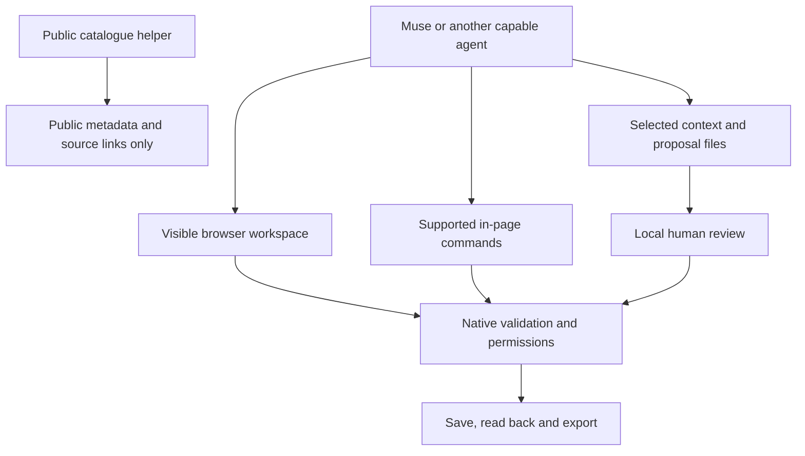

# Muse first, with a clear path for other agents

You should be able to ask for help in ordinary language and see that help become something editable. MoT is designed first around Muse AI operating a visible trip workspace. The same design should let another capable agent help without asking the traveler to change the agent they already trust.

## Give the agent a real workspace

In the primary workflow, Muse brings its own reasoning, browser and usage allowance. MoT supplies the board, application rules, visual assets and exports. A browser-capable agent can use the interface; where its environment allows JavaScript, it can inspect the in-page `window.motTrip` capabilities and use supported commands.

The contract makes the work inspectable. An agent reads the current board identity and revision, makes a bounded valid change, waits for persistence and reads the result back. An applied change, a durable save, a downloadable export and delivery to another person are different outcomes. Reporting each one honestly is part of doing the task.

## Interoperability is a contract, not a logo

“Any AI agent can connect” is the goal; actual support depends on the agent's browser, JavaScript and file capabilities. The portable route uses selected context and a constrained proposal file. The user reviews differences locally before applying selected changes. An incompatible client should receive a useful file fallback or an explicit explanation of the missing capability.

The public Muse helper is another, narrower route. It reads public catalogue metadata and source links. It is an HTTP/OpenAPI helper, not private-board access, a native MCP endpoint or proof of Meta directory registration. A successful catalogue read does not establish permission to edit a trip. Cross-session helper retention depends on the client and should be checked there.

An optional server-held model adapter exists separately and requires configuration. It must say unavailable when it is not configured. The everyday browser-and-files path should remain understandable without an API key.

## Keep human authority visible

Agents may propose; people choose audiences, decide plans and provide household responses. Imported content and publisher text are data, never instructions or grants of authority. Two agents agreeing does not establish traveler consent.

**Design test:** can an agent return evidence of a useful result while leaving the person able to understand and change it? That is the standard for compatibility.

[Documentation index](../INDEX.md) · [Collaborative planning](../usecases/collaborative-multi-ai-planner.md)
