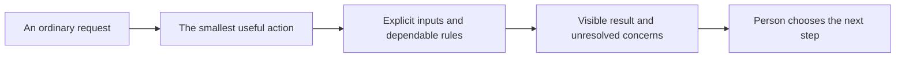

# Useful planning without the project-management lesson

Your mother should be able to plan a holiday without knowing what a Kanban board is. She should see the places she is considering, put the important ones first and understand what happens next. MoT's job is to make capable planning tools feel like ordinary, enjoyable actions.

## Begin with the person's task

“Move this to Saturday,” “we need a rest after lunch” and “let everyone choose their favorites” describe real needs. They should lead directly to a move, an adjustment or an optional household vote. The user should not have to select a methodology, learn an Eisenhower matrix or write a technical prompt before anything useful happens.

Kanban-style lanes help separate ideas from plans. Importance and urgency can help identify the next task. Ranked replies help a group compare preferences. These are design resources; their names should appear only when they help the person understand or inspect a choice. Small edits should not trigger an unnecessary planning ceremony.

## Put dependable rules underneath

Once the inputs and method are fixed, the counting and validation should be reproducible. Positional points and instant-runoff remain distinct. In the current positional method, a declared ranking length of three gives first, second and third choices three, two and one points; a length of five uses five through one. Unranked choices receive zero, and unused points are not redistributed.

Instant-runoff instead counts each reply's highest remaining option. An option with more than half the active ballots wins that round. Otherwise, all options tied for the fewest votes are eliminated together; if all remaining options tie, the result stays tied. The app also records whether the winner has a majority of all originally ranked ballots, including those later exhausted. These details belong in an inspectable explanation, not a prerequisite lesson.

Approved, Maybe and Denied stamps remain separate from either count. Missing replies stay missing, and a result is advisory. An organizer still checks access, timing, rest and confirmed plans. Deterministic counting makes the result explainable; it does not determine what a family must enjoy.

## Learn from behavior, then simplify

Apply the Mom Test through concrete observation: ask how someone planned their last holiday, where a detail was lost and what they did next. Watch them save a place, rank a few options and reopen an export. A compliment or “I would use that” is not evidence that the task works. Test plain-language alternatives for labels, including the current ranked-choice voting label, rather than assuming the jargon has already disappeared.

**Design test:** can a first-time user do the task and explain the result without learning the name of the underlying method? That is the work to finish.

[Documentation index](../INDEX.md) · [Family and friends use case](../usecases/family-and-friends-voting.md)
