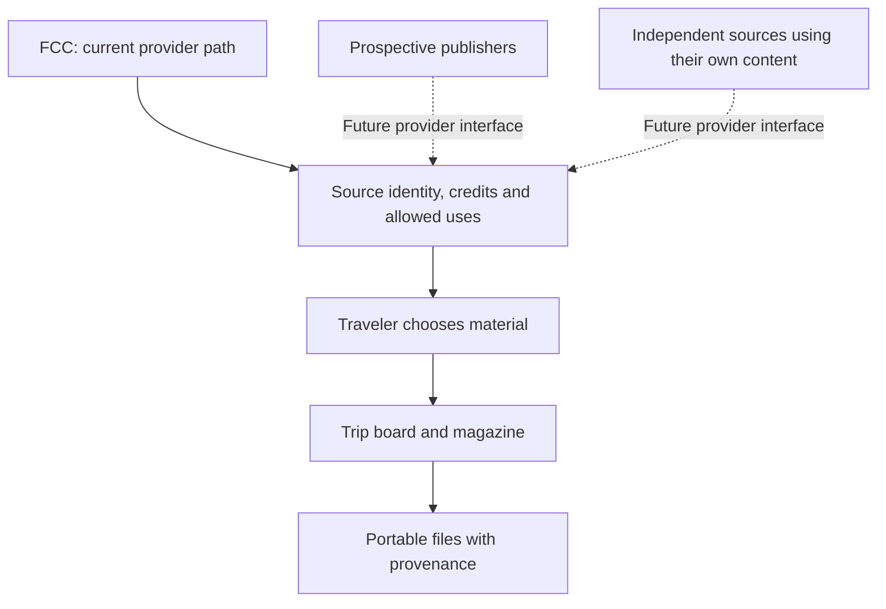

# Connect good sources without collecting everyone's life

A travel workspace should help you use the sources you trust. MoT's direction is a network of publishers and data providers that can contribute useful material while travelers keep their own plans. The app becomes a place to compose that material around a trip, with its source and terms intact.

## FCC is the first concrete example

Foreign Clubbers Correspondence supplies the current city-content path: stories, places, artwork, stickers and apparel references. The code and catalogue handling are presently FCC-specific. Public metadata can point to original content and images, while a person deliberately chooses what enters a board or magazine.

That separation matters. A publisher's story is a source, a traveler's note is their own observation, and a current venue fact needs an appropriate current source. A dated catalogue record should never quietly become a live claim about price, opening hours or stock. If a source is unavailable, the app should show the gap rather than substitute an unrelated city's material.

## Make room for other editorial voices

Condé Nast Traveler, Wallpaper* and Lonely Planet are examples of publishers we would like to connect with. They are prospective relationships, not announced partners or implemented integrations. Each could bring a different point of view, audience and set of rights. Independent publishers using their own content should have the same opportunity.

A future provider interface should preserve stable source identities, credits, rights, retrieval dates and supported operations. Discovery permission, permission to include an image in a personal keepsake, and permission to manufacture merchandise are different decisions. The source-code license does not silently license a publisher's articles or artwork.

## Use the useful part of the web3 idea

Here, “web3-like” expresses an architectural preference: portable user material, independently operated sources and fewer reasons to surrender a whole personal dataset. It does not claim a blockchain, token, wallet, decentralized identity system or smart-contract implementation. Those mechanisms would need a demonstrated user benefit before becoming product requirements.

The practical first step is modest: choose a source, inspect what it offers, preserve its provenance and use permitted material in your own trip. The local [Discover more places](../usecases/discover-more-places.md) preview extends that reasoning to public search excerpts: an inspectable source can support a suggestion without becoming a venue guarantee or publisher endorsement. Its public funded backend remains in progress. Broader interoperability should strengthen that loop without making travelers learn the machinery behind it.

**Design test:** can the reader identify where a recommendation came from and what they may do with its assets? A connected catalogue earns trust when those answers travel with the content.

[Documentation index](../INDEX.md) · [Local guide use case](../usecases/local-guide.md)
