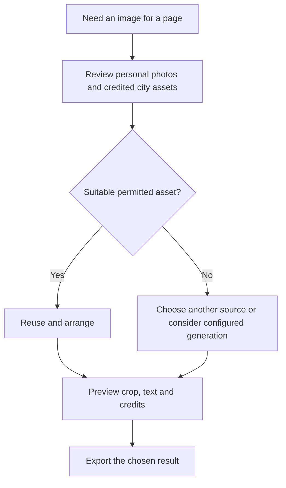

# Give people good images before asking them to generate more

A traveler should not have to describe a visual style from scratch to make a pleasing trip magazine. MoT starts with existing city artwork, stickers and the traveler's own photos. Those assets give people something attractive to choose, arrange and discuss before another image needs to be made.

## Reuse removes a repeated task

If a suitable city illustration already exists and its use is permitted, the app can place that asset through ordinary code. That particular placement needs no new image-generation request. Reusing an asset can therefore avoid another prompt, generation attempt and wait. Fetching, decoding, arranging and exporting the image still take resources and time.

The expected savings depend on the workflow. A person who would otherwise generate several alternatives may avoid repeated model use; a person who never planned to generate an image has no such generation cost to remove. We have not established a measured percentage reduction in tokens, latency or cost. Compare real workflows before making numerical claims.

## References make choices easier

Concrete images also reduce ambiguity. A traveler can say “use this city's red illustration” or “keep this photo large” instead of inventing a detailed art-direction prompt. Consistent assets make it easier to choose a palette and maintain a sense of place across a board, postcard and magazine.

The result can look more considered because the source material gives it a coherent starting point. It still needs judgment. Preview crops and text, keep the original location and credits visible, and avoid using decorative imagery as evidence of a real venue or event. Attractive assets should support the person's story.

## Keep generation and rights deliberate

The preferred sequence is to reuse the traveler's media and suitable credited assets, then consider whether anything is missing. Image generation is an optional, separately configured path whose availability, cost and output need their own confirmation. The local [City Ink](../usecases/city-ink-architecture.md) and [Fashion Illustration](../usecases/photo-fashion-illustration.md) workflows show where a deliberate new image can serve a personal story. They require review, preserve the original and produce opaque output; reference-image integration and deployment remain separate work. The public catalogue helper supplies metadata and source links; it does not generate images or transfer private photos.

Permission to include artwork in a personal trip is different from permission to sell a sticker pack or manufacture a shirt. Preserve asset-specific terms and inspect the original source before a new use. Good references save work only when the proposed use is actually allowed.

**Design test:** can someone make a page they like with a few visible choices? Measure avoided generation requests, waiting and rework in that task, rather than assuming a universal token saving.

[Documentation index](../INDEX.md) · [Magazine use case](../usecases/travel-magazine.md)
