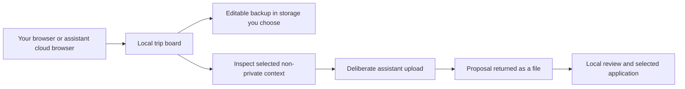

# Your trip belongs in your workspace

You should be able to plan a holiday without first giving a travel platform your personal history. MoT's direction is to bring the workspace to you: your browser, your files and, when you choose one, your own assistant's cloud computer. The useful exchange is the help you requested, with the context needed to provide it.

## Ownership begins with a usable copy

The current board saves in the browser profile running MoT, using browser-local storage. If Muse operates the app in its cloud browser, that browser environment holds the working board. It is a different environment from your phone or laptop. Opening the same website elsewhere does not automatically reveal the same trip.

Editable ZIP exports make that boundary manageable. Keep a copy in storage you control and deliberately move it when you want to continue elsewhere. A downloaded magazine serves a different purpose: it is a reading snapshot. Neither an open tab nor an assurance from an agent replaces checking that the file exists and can be reopened.

## Share the context needed for the task

The selected-context workflow lets you inspect the non-private card text and optional public asset references before downloading a handoff. You choose whether to upload it into your own assistant conversation. The assistant receives no live board access through that file. Its returned proposal is reviewed and applied locally, against the original request and board state.

For example, asking for an afternoon suggestion may require the neighborhood, available time and an access preference. It does not inherently require a passport, payment information or a hotel access code. The design goal is to make that smaller exchange convenient enough that people do not have to overshare to get useful help.

## Control needs honest boundaries

Browser-local storage is not a claim of end-to-end encryption, guaranteed retention or universal privacy. Devices can be shared, browser data can be cleared, and cloud-browser and assistant providers have their own storage and processing policies. Public catalogue requests can also leave ordinary hosting request metadata. Optional configured model requests have a separate processing boundary.

Downloaded files remain with their recipients. Changing a card or revoking future access cannot recall an earlier copy. MoT should help people see what they are sending and retain a usable backup, rather than ask them to trust a broad promise that nothing ever leaves their computer.

**Design test:** can a person explain where the working board lives, what they sent, and how they will recover it? If those answers are unclear, the ownership experience needs work.

[Documentation index](../INDEX.md) · [Sharing use case](../usecases/sharing-with-private-notes.md)
