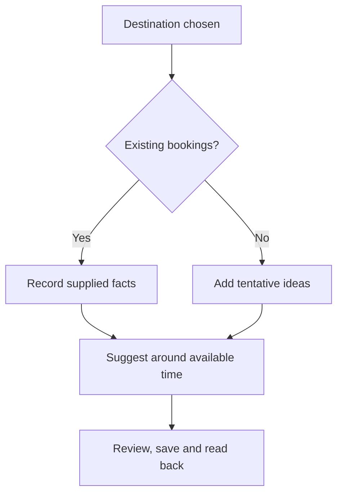

# Destination chosen: start with the plans you have

Knowing where you are going does not mean the rest of the trip is settled. You may have flights and a hotel, only a few saved places, or nothing beyond a city name. MoT lets you begin at any of those points and build around the facts you actually have.

If you have bookings, add the details that help you plan: dates, relevant times, locations and the source of the information. Keep sensitive codes in private material or outside the board when they are unnecessary. A card marked as a booking should describe a real booking you supplied, rather than an agent's guess dressed as a confirmation.

If nothing is booked, begin with tentative ideas. A possible arrival day, a neighborhood to explore and an open evening are enough to make the board useful. Avoid inventing flight numbers, reservation references, prices or a hotel stay merely to make the trip look finished. The difference between “considering” and “confirmed” should survive every edit and export.

Use Muse for the spaces between fixed plans. Ask for a relaxed afternoon, a meal near a saved place or an alternative that suits someone's access needs. Where travel time, opening hours or cost is unknown, keep the proposal tentative. Changing a date or destination means checking the affected suggestions again.

Review the result as a person who will actually take the trip. Is there time to arrive, rest and get between places? Does every fixed commitment still appear correctly? Save, reload and check the important cards before relying on them.

Success is a plan that grows from reality. A partially planned trip with honest gaps is more useful than a polished schedule whose certainty came from the software.

## User journey map

| Moment | Traveler's need | Action | Useful result |
| --- | --- | --- | --- |
| Start | Use existing progress | Choose the city; add available plans | A board without prerequisites |
| Anchor | Protect fixed commitments | Record supplied booking facts | Clear fixed and tentative items |
| Fill gaps | Find suitable options | Ask Muse about specific free time | Suggestions around the anchors |
| Review | Check practical fit | Inspect sources, rest and travel gaps | Fewer hidden assumptions |
| Preserve | Trust the saved version | Save, reload and export | Recoverable plans |

[Documentation index](../INDEX.md) · [Solo traveler](solo-traveler.md)
