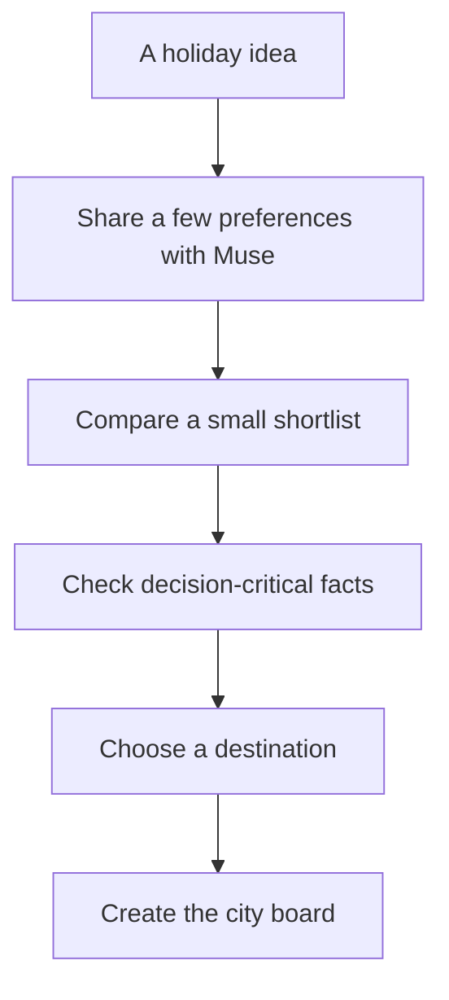

# No destination yet: turn a vague holiday into a choice

You should be able to start planning before you know where to go. Perhaps you want a long weekend, good food and a manageable journey, but a blank itinerary asks for answers you do not have. MoT's role is to help you reach a useful first choice, then give that choice a place to grow.

Begin with the life around the holiday. Tell Muse the time you have, the people coming and one or two things that matter. “Somewhere we can walk slowly and eat well” is a workable starting point. You can skip a question or say you are unsure. The conversation should reveal possibilities without becoming a form to complete.

Compare a small set of destinations before filling a board with activities. Use public city stories, places and artwork as reference material where the catalogue has coverage. A story can help you imagine the place; it cannot prove today's airfare, visa rules or hotel availability. Those questions need current sources before money or dates depend on them.

Once a destination feels right, choose that city in MoT and bring across the options you want to keep. The current app creates a destination-specific board; a dedicated comparison workspace across several cities is a product direction, rather than a feature established by this documentation. Muse can help with the comparison in conversation and then work on the chosen board.

The handoff matters. Record why you chose the city, what remains uncertain and the first useful next step. Someone reopening the trip should see a decision they can understand, rather than a confident itinerary built on guesses.

Success is permission to begin with uncertainty and finish with one destination worth exploring. You do not need flights, a hotel or a complete plan to get there.

## User journey map

| Moment | Traveler's need | Action | Useful result |
| --- | --- | --- | --- |
| Imagine | Find a starting point | Describe the kind of break | A few usable preferences |
| Compare | See meaningful differences | Ask Muse for a shortlist | Options and explicit unknowns |
| Check | Avoid an impractical choice | Verify facts that affect the decision | A grounded comparison |
| Choose | Begin without overplanning | Select a destination in MoT | An empty city board |
| Continue | Preserve the reason | Save a note and a few ideas | A clear next step |

[Documentation index](../INDEX.md) · [Booked and unbooked planning](booked-and-unbooked-planning.md)
