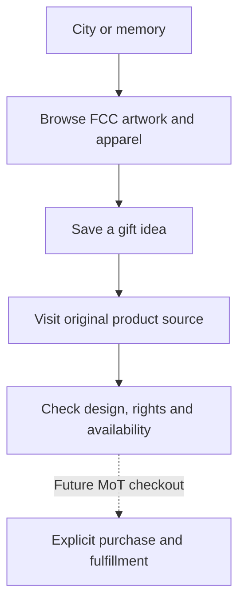

# City art: find a souvenir with a reason behind it

A souvenir feels more personal when it points to a place or memory that matters. MoT connects the visual world of a trip with FCC city artwork and apparel ideas, so a gift can begin with a story rather than a search for something generic.

Start with the city and the person. Perhaps a friend loved the food on a particular trip, or a family member would enjoy artwork from the place they grew up. Browse relevant city imagery and FCC's apparel collection, keeping track of designs that suit the person. Existing artwork offers a concrete reference for the conversation; you can discuss what you can actually see.

Keep inspiration separate from an order. The current experience supports browsing and referrals to FCC's collection. A city shop link sends no trip context and does not choose a design, size, price or stock level for you. Saving a gift idea does not reserve a product, charge a card or establish delivery.

Use the provider's product information when purchase decisions become relevant. MoT's carousel contains illustrative scenes based on FCC references, and pictured shirt details may differ from original designs. Do not use those scenes as a manufacturing proof. Follow the original source and its terms for the actual item.

The same distinction applies to making your own merchandise. Permission to use an image in a personal MoT keepsake does not automatically allow printing and selling it on shirts. Asset-specific rights still govern that use. Printed photo books and in-app T-shirt checkout remain future directions in the inspected materials.

Success today is a meaningful, traceable shortlist of souvenir or gift ideas. A future purchase experience should preserve that clarity all the way through product selection, checkout and fulfillment, with each stage honestly labeled when it becomes available.

## User journey map

| Moment | Shopper's need | Action | Useful result |
| --- | --- | --- | --- |
| Remember | Choose something meaningful | Pick the city and recipient | A personal reason to browse |
| Explore | See real references | Browse credited art and apparel | A visible shortlist |
| Verify | Know what an idea represents | Open original product information | Clear source and rights |
| Save | Keep a possible gift | Record favorites | An idea without an order |
| Continue | Make a separate purchase decision | Check provider availability | No invented transaction |

[Documentation index](../INDEX.md) · [Publisher connections and rights](../philosophy/publisher-connected-architecture.md)
