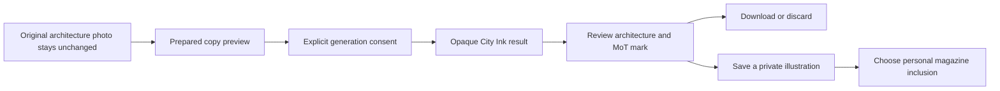

# City Ink: turn a street photograph into architecture art

**Status:** Local implementation and reference-image integration are in progress. This feature is not included in the current public app source and is not deployed.

A photograph can record the street you walked down; an illustration can give that memory a different place in your magazine. City Ink is MoT's locally implemented treatment for turning a chosen street or architecture photo into an opaque illustration with fine architectural lines and a restrained blue accent.

Start with a photo you have permission to use. Choose Create photo illustration and the City Ink treatment. Selecting a file prepares a preview without uploading it. The local flow checks the image, makes a smaller re-encoded copy and removes embedded file metadata, including embedded location metadata, from that prepared copy. Visible buildings and street signs can still reveal where it was taken. Your original remains unchanged, and the source photo is not automatically registered as a board asset.

Review what will leave the device before generating. The current local implementation requires an explicit paid request and the user's own session key; the image request sends the prepared photo and style instructions to Meta. Choosing a file is not that consent. Other board photos, notes and bookings are not added to the request automatically. Closing the panel drops its source-photo and key state, while cancellation cannot guarantee the provider has stopped charging.

Judge the returned picture as an interpretation. Building proportions, framing and recognizable details may change. The local implementation adds the MoT mark to the generated image; its placement also needs review. The result has an opaque background. It is not a transparent cutout, an architectural survey or proof that a place looked exactly this way.

Download, discard or explicitly save the illustration as a private photo card. Private output stays out of the default Public copy. Including it in a personal magazine preview or Review export is a separate choice, and that broader copy may include other private material too.

City Ink is implemented locally and has fixture/browser coverage. Approved reference-image integration is underway; the final reference-guided treatment and live fidelity are not established here, and the feature is not yet deployed. Success is artwork you chose and reviewed, with the original photo still yours to keep.

## User journey map

| Moment | Traveler's need | Action | Useful result |
| --- | --- | --- | --- |
| Choose | Preserve a meaningful street | Select a permitted source photo | Original file remains unchanged |
| Prepare | See the actual input | Inspect the prepared photo and treatment | A deliberate visual starting point |
| Generate | Understand sharing and cost | Explicitly authorize the configured request | An opaque illustration for review |
| Review | Retain control over interpretation | Inspect buildings, framing and lettering | Keep, discard or download |
| Keep | Add art without sharing it by default | Save privately; choose personal inclusion later | An intentional magazine asset |

[Documentation index](../INDEX.md) · [Fashion illustrations](photo-fashion-illustration.md) · [Keepsakes](scrapbook-and-keepsakes.md)
