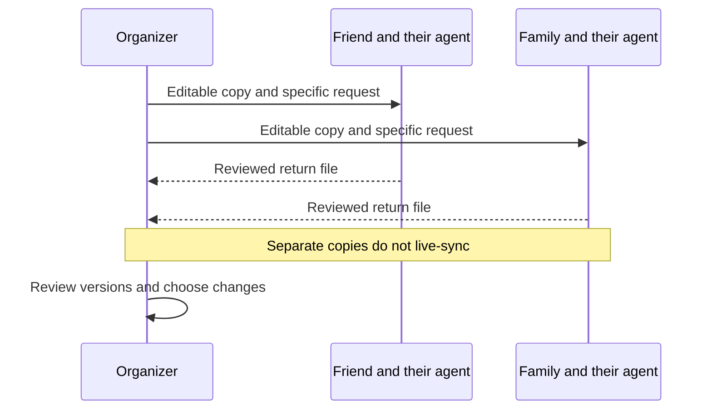

# Plan together with the agents you already use

A group trip should not require everyone to move into one account or one conversation. One friend may use Muse, another may work by hand, and a household may ask its own browser-capable agent for help. MoT gives them something concrete to exchange: an editable trip package.

Start with an organizer and a clear version. The organizer prepares a board, exports the appropriate ZIP and tells each person what kind of response would help. “Add two afternoon ideas and explain who they suit” is easier to review than “make the trip better.” Each recipient opens a separate copy and can work with their own agent.

Keep recommendations distinct from decisions. An agent can inspect permitted content, add suggested places and write plans in the relevant card's Notes field. A separate note should identify the card it concerns. If two agents agree, label the result an agent-recommended draft with traveler choice pending. Agreement between software agents is never a household vote or human approval.

Return files deliberately. A Review copy carries private material and voting information, so use it only with a trusted collaborator after inspecting the contents. For narrower help, use selected non-private context and the proposal-file workflow. Those proposals return to the original board for local inspection and selective application; sending a file grants no remote access.

The current collaboration path is file exchange. Separate copies do not synchronize automatically, and importing a returned package is not a promise of automatic conflict-free merging. Keep the original and returned versions until the organizer has reviewed them. Household reply files use their own reconciliation rules.

Success is a handoff another person can continue: readable plans, useful suggestions and a version everyone can identify. The group can share the work while people keep authority over their own choices.

## User journey map

| Moment | Participant's need | Action | Useful result |
| --- | --- | --- | --- |
| Prepare | Know what help is wanted | Organizer labels a version and request | A bounded assignment |
| Exchange | Work in a familiar environment | Receive and import the ZIP | An independent editable copy |
| Contribute | Make useful changes | Person or agent adds clearly labeled proposals | Reviewable contributions |
| Return | Preserve meaning and scope | Inspect and export the intended copy | A deliberate file handoff |
| Reconcile | Choose what belongs | Organizer compares returned work | A human-reviewed next version |

[Documentation index](../INDEX.md) · [Household decisions](family-and-friends-voting.md) · [Agent philosophy](../philosophy/muse-first-open-to-agents.md)
