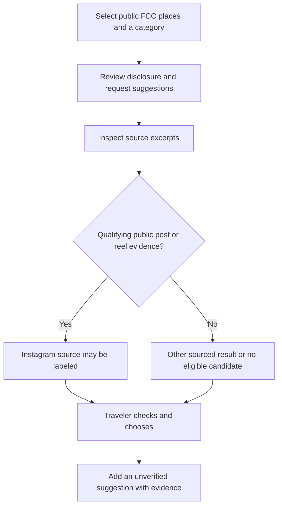

# Discover more places: follow a good lead beyond the guide

You have found a café you like in the city guide. Now you want to know what else belongs in that part of your trip: another place with a similar atmosphere, an interesting gallery nearby, or somewhere appearing in a public Instagram post. MoT's discovery direction is to turn a few good starting points into a short, sourced list you can judge.

Begin in Explore FCC with the selected city's public catalogue. Choose one to three places and a category, then review the disclosure before asking Muse for related suggestions. This local preview uses public catalogue inputs. It does not send your private board, bookings, photos or notes into discovery, and you do not need to provide a personal travel history to express that interest.

Read the evidence beside each suggestion. A candidate needs a returned search source and an excerpt connecting it to a selected FCC place. An Instagram label requires qualifying evidence from a readable public post or reel; a profile link or a model-written URL is insufficient. That does not establish access to your Instagram account, private posts or a complete Instagram search service. Some requests may return no eligible candidates.

Keep the distinction between discovery and verification. A search excerpt can support why a place was suggested without proving its current hours, exact location, popularity or suitability. The displayed search time is not a publication date. Open the source and check the details your plans depend on before choosing Add to board. The saved suggestion remains unverified and keeps its evidence.

This feature is implemented as a local preview. A secured public funded backend and its usage controls are in progress; this documentation does not announce a live discovery service. If discovery is unavailable, the existing guide and manual board remain useful.

Success is a promising new lead with an explanation you can inspect. The final decision belongs to the traveler, including the decision to keep looking.

## User journey map

| Moment | Traveler's need | Action | Useful result |
| --- | --- | --- | --- |
| Notice | Find more of what appeals | Select a few public FCC places | Concrete starting points |
| Request | Understand the exchange | Choose a category and review the disclosure | A deliberate public-input request |
| Inspect | Know why a place appeared | Read related seed, excerpt and source | Traceable suggestions |
| Check | Avoid misplaced confidence | Verify decision-critical venue details | Unknowns stay visible |
| Keep | Bring a useful lead into the trip | Choose Add to board | An unverified card with evidence |

[Documentation index](../INDEX.md) · [Local guide](local-guide.md) · [Publisher philosophy](../philosophy/publisher-connected-architecture.md)
