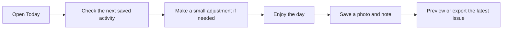

# On the trip: help with today and keep the good parts

Once you are traveling, the board should reduce the work of the day. You may want to see what comes next, find something for a free hour or save the story behind a photograph. MoT lets you begin with that immediate need without making you plan the holiday again.

Open Today to see the next saved activity and the information it depends on. Treat a saved time as a saved fact with a source, rather than proof that the venue is open now or transport is running. If you need current information, check the relevant source before making the day depend on it.

When plans change, keep the adjustment small. Tell Muse that you are tired or running late and ask about the affected part of the trip. Suggestions should respect confirmed commitments and leave missing travel times or access facts visible. A proposed adjustment does not move a booking by itself, cancel a ticket or buy a replacement.

Add memories while you can still remember why they mattered. Choose a photo and write a short note about the person, place or moment. You do not need to answer preference questions, reopen a household vote or generate a new itinerary to save a caption. Small edits should stay small.

Build the magazine gradually if that feels enjoyable. Preview the latest pages, keep an image you like and export a fresh issue when you want to share. An older export remains an older snapshot; it does not update when you change the board. A downloaded standalone HTML magazine can be read offline, while the app and external content still depend on what is available in that environment.

Success is a day with fewer administrative interruptions and a record that still feels like your trip. Save a useful detail, enjoy the next thing and leave the rest for later.

## User journey map

| Moment | Traveler's need | Action | Useful result |
| --- | --- | --- | --- |
| Morning | Know the next step | Open Today | The next saved activity and its context |
| Change | Recover without a full replan | Request a narrow adjustment | A proposal around fixed plans |
| Pause | Preserve a fresh memory | Add a photo and caption | A moment attached to the trip |
| Evening | See the story taking shape | Preview the magazine | An issue built from real material |
| Share | Send the current version | Review scope and export again | A deliberate snapshot |

[Documentation index](../INDEX.md) · [Travel magazine](travel-magazine.md)
