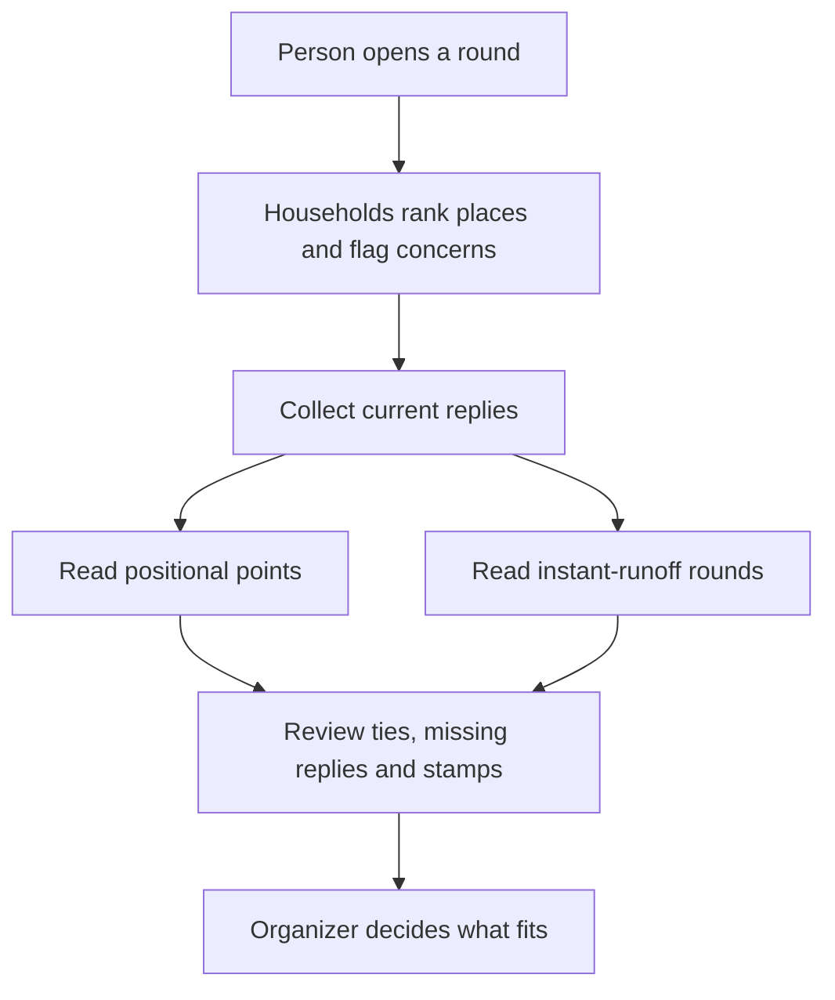

# Family and friends: hear everyone before choosing

A holiday becomes hard to organize when the loudest suggestion becomes the plan. One household wants a museum, another wants a market, and someone quietly needs less walking. MoT helps the group make those preferences visible before the organizer decides what fits.

Begin with a small set of real options. Give each option enough information to judge: what it involves, what remains unknown and any practical concerns. Offer a household vote when it would help. A simple photo edit or note does not need a voting round, and a person should choose when a round opens.

Each participating household ranks its favorites and can express Approved, Maybe or Denied separately. A high rank means preference; it does not erase an access concern or turn a reluctant participant into an enthusiastic one. An absent response remains absent, rather than becoming a vote inferred by an agent.

Read the result with its method visible. Positional points award decreasing points to ranked choices. Instant-runoff counts each household's highest remaining choice through successive rounds. These are two different ways to read ranked replies and can produce different results. The app keeps ties explicit. The accompanying philosophy document explains the mechanics for readers who want them; families should be able to start by simply ranking places.

Collect returned household reply files and resolve sender labels deliberately. Closing a round preserves an advisory result. It does not book a restaurant, apply a schedule or override a Denied stamp. If the trip changes substantially, ask people again in a fresh round rather than carrying forward old consent.

Success is a decision people can understand, including the concerns that shaped it. The organizer still checks timing, access and rest, then chooses a trip that works for the people coming.

## User journey map

| Moment | Group's need | Action | Useful result |
| --- | --- | --- | --- |
| Gather | Make alternatives understandable | Create a bounded list of places | Comparable choices |
| Invite | Give each household a voice | Person declares and opens a round | A clear current request |
| Respond | Express preference and concerns | Rank favorites; use independent stamps | Explicit household input |
| Compare | See agreement and uncertainty | Read points or instant-runoff and coverage | An advisory result |
| Decide | Make a feasible trip | Organizer checks concerns and chooses | A human decision |

[Documentation index](../INDEX.md) · [How the counting stays understandable](../philosophy/project-management-for-everyone.md)
