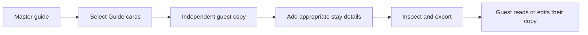

# Host and guest: give a welcome people can use

A good host guide answers the questions a guest is likely to ask, without sending the host's whole planning life along with it. MoT lets a host build a reusable city guide and create a separate guest copy from selected Guide cards.

Start with the welcome you would give in person. Add a few places you recommend, practical notes that you are comfortable sharing and a sense of the neighborhood. FCC city stories and credited art can give the guide a visual identity. Keep host-only reminders and details intended for one stay outside the reusable Guide scope.

Create the guest copy by checking the Guide cards to include. The selection panel shows other cards as excluded, and the master guide stays unchanged. Give the copy a clear title, then add the stay information appropriate to those guests. A specific arrival time belongs to a particular visit; it should not quietly become a permanent instruction for every future visitor.

Review the actual file before sending it. Public copy can include shared stay information unless you choose Guide only. Review copy includes private material. Those labels are practical choices about contents, rather than a way to recall information after someone downloads it. Leave out access codes or personal details that do not need to travel in the file.

Guests can read the exported magazine or import an editable ZIP into their own MoT browser. They can add plans, notes and memories to their copy, with help from their own agent if they wish. Their edits do not automatically update the host's master guide or create a shared live room.

Success is a guest who arrives with useful local context and a host who can reuse the good work. The welcome remains personal without requiring the host to rebuild it for every visit.

## User journey map

| Moment | Person's need | Action | Useful result |
| --- | --- | --- | --- |
| Prepare | Reuse local knowledge | Mark reusable cards as Guide | A master welcome guide |
| Tailor | Help these particular guests | Select Guide cards for a guest copy | A separate, named board |
| Review | Share the right details | Add stay information; inspect scope | An intentional handoff |
| Visit | Make the guide their own | Guest reads or imports the package | Plans they can use and edit |
| Improve | Preserve useful learning | Host reviews returned suggestions manually | A better future welcome |

[Documentation index](../INDEX.md) · [Sharing and private notes](sharing-with-private-notes.md)
