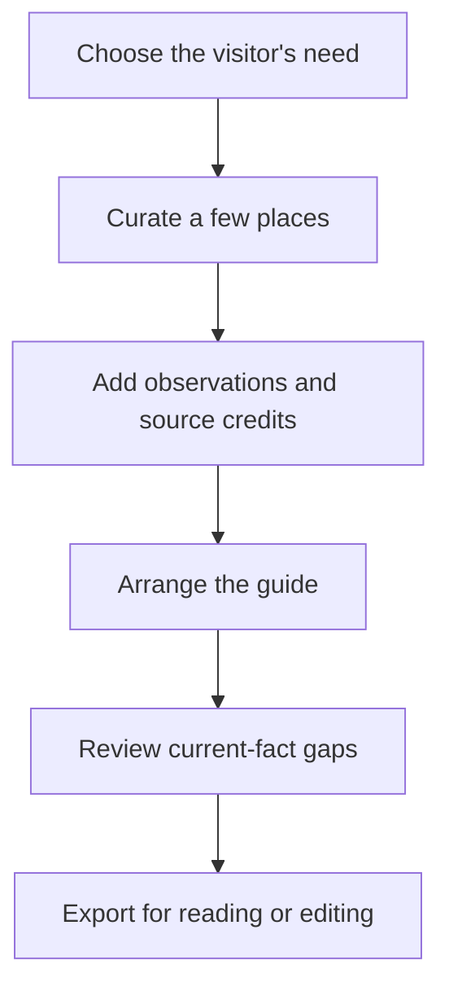

# Local guide: make your knowledge easy to carry

Local knowledge is most useful when a visitor can act on it. A list of fifty recommendations leaves the visitor to do the organizing. MoT gives a local guide, neighborhood enthusiast or returning traveler a way to make a considered selection with enough context to use it.

Begin with a particular reader. A first-time visitor with one free afternoon needs something different from a family staying a week. Choose a manageable set of places and explain why each belongs. A note such as “a quiet place to pause between these two stops” tells the visitor more than a generic claim that somewhere is a hidden gem.

Keep your observations separate from published source material. Add your perspective as a traveler note, preserve the original article's credit and link, and label details that may have changed. The current catalogue is a dated source of city content, rather than a live guarantee of hours, ticket prices or availability. Visitors should verify the details their plans depend on.

Make the guide visually inviting with appropriately licensed photos, city artwork and stickers. A consistent visual language helps the reader recognize the place and follow the pages. It should also make missing information easier to notice, rather than disguising uncertainty beneath a finished layout.

Share a reading copy when the visitor wants orientation, or an editable ZIP when they want to adapt the guide to their trip. You can create selected Guide-card guest copies for different audiences. Current distribution is through deliberate files; this workflow does not establish a creator marketplace, subscriber system or paid publishing agreement.

Success is a visitor who understands a few good choices and can shape them to their own pace. Your expertise becomes something portable, while its source and limits remain clear.

## User journey map

| Moment | Guide's need | Action | Useful result |
| --- | --- | --- | --- |
| Focus | Serve a real reader | Choose audience and available time | A useful editorial brief |
| Curate | Reduce research work | Select places and explain their role | A coherent shortlist |
| Ground | Preserve trust | Add sources and label dated facts | Traceable recommendations |
| Shape | Make the guide readable | Arrange cards, notes and credited art | An inviting guide |
| Hand over | Let visitors adapt it | Export a magazine or editable copy | Portable local knowledge |

[Documentation index](../INDEX.md) · [Discover more places](discover-more-places.md) · [Publisher connections](../philosophy/publisher-connected-architecture.md)
