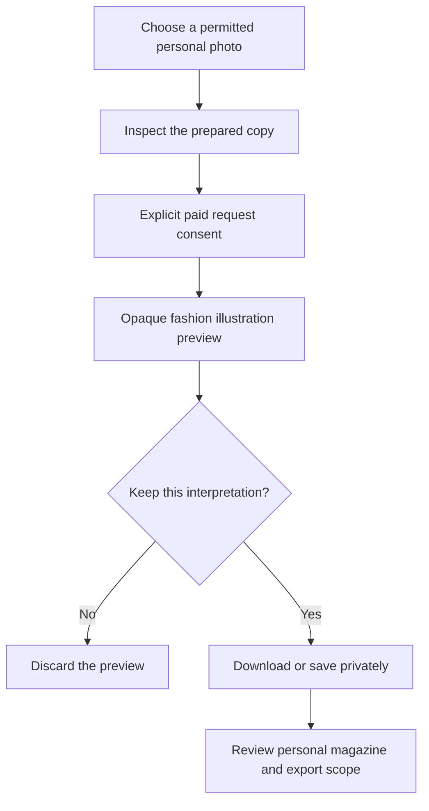

# Fashion Illustration: make a personal portrait for your trip

A favorite travel photo can become more than another picture in the camera roll. MoT's Fashion Illustration treatment is designed to turn a chosen photo of a person into an editorial illustration: fine ink contours, restrained color and a plain background that can sit comfortably in a personal trip magazine.

Begin with a photo you are allowed to use and consider the people pictured before sending it to an image provider. Choose Create photo illustration and Fashion Illustration. Selecting the photo does not upload it. The local flow prepares a smaller re-encoded copy, removes the original file metadata from that copy and lets you inspect it first. The original file remains unchanged.

Generation is a separate, explicit decision. In the current local implementation, the user supplies a key for the session and agrees to a paid request sending the prepared photo and style instructions to Meta. No private board photo is selected automatically. Other trip cards, bookings and notes are not silently bundled into that request. The provider's processing terms still apply to the image you choose to send.

Review the output before treating it as your portrait. The treatment aims to retain the visible pose, clothing and crop, but likeness and small details may be redrawn. The output is opaque, with no automatic background removal. A white background is not transparency, and an illustration should not be presented as an unchanged photograph of what happened.

Choose whether to download, discard or save the result. Saving creates a private illustration card for the magazine; it does not add the source photo to the board. The default Public copy excludes that private result. To include it in your personal magazine, deliberately enable private material in the preview and review the export scope again before sharing.

Fashion Illustration is implemented locally, with approved reference-image integration underway. It is not yet deployed, and final reference-guided fidelity is not established by fixture or browser tests. Success is a portrait you recognize and choose to keep, without surrendering control of the original or its audience.

## User journey map

| Moment | Traveler's need | Action | Useful result |
| --- | --- | --- | --- |
| Select | Use a meaningful, permitted image | Choose a personal photo | An unchanged original |
| Inspect | Know the actual input | Review the prepared copy | No upload merely from selection |
| Authorize | Understand provider sharing and cost | Explicitly request generation | An illustration preview |
| Judge | Decide whether the result feels right | Inspect likeness, clothes and composition | A personal keep-or-discard choice |
| Compose | Use it without default public sharing | Save privately and choose inclusion | A reviewed magazine portrait |

[Documentation index](../INDEX.md) · [City Ink](city-ink-architecture.md) · [Visual asset philosophy](../philosophy/visual-assets-before-generation.md)
