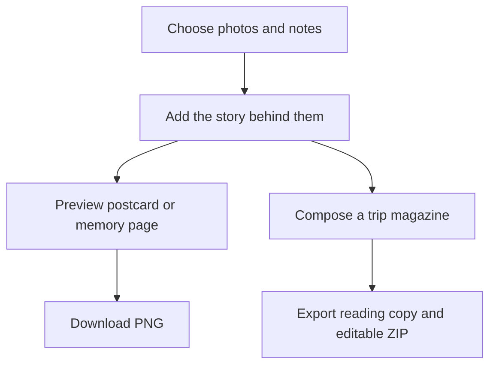

# After the trip: keep the story behind the photos

A camera roll remembers what the trip looked like. It rarely remembers why a moment mattered. MoT helps you turn a few photos and notes into something you will want to reopen: a postcard, a memory page or a trip magazine.

Start after the trip if that is when you have time. You do not need to reconstruct every booking or complete a planning workflow first. Create a board for the destination or reopen the one you used, add the photos you want to keep and write the details that only you can supply.

Choose a small set of memories before arranging pages. A slightly blurred family photo may tell more of the story than a perfect building shot. Muse can help organize permitted material and suggest wording, but it should not invent events, conversations or feelings. A good caption gives the photograph context without replacing your experience.

In Keepsakes, select a photo, choose Postcard or Memory page and edit the note. The preview updates to match the downloadable PNG. The original photo remains unchanged. If the selected photo bytes are missing, restore them from a ZIP containing the media or choose another photo; an empty preview should not be treated as a finished keepsake.

Reuse city artwork and existing credited assets where they help the story. Then preview the magazine for missing pictures, clipped text and details you do not want to share. Download an HTML reading copy, a screen-friendly PDF or an editable ZIP with the permitted media. Review copy includes private content, so inspect it before handing it to someone else.

Success is a memory with enough context to stay meaningful. Printed photo books and fulfillment are future possibilities; the supported result here is a digital keepsake you can read, share or edit.

## User journey map

| Moment | Traveler's need | Action | Useful result |
| --- | --- | --- | --- |
| Return | Start without rebuilding the trip | Open or create the destination board | A home for memories |
| Choose | Avoid sorting everything | Pick a few photos and notes | A manageable selection |
| Tell | Preserve what happened | Write captions in personal language | Context that belongs to the traveler |
| Make | See a tangible result | Preview Postcard or Memory page | A downloadable digital keepsake |
| Keep | Retain editing options | Export a reading copy and ZIP | A story and its source material |

[Documentation index](../INDEX.md) · [Travel magazine](travel-magazine.md) · [City Ink](city-ink-architecture.md) · [Fashion Illustration](photo-fashion-illustration.md)
