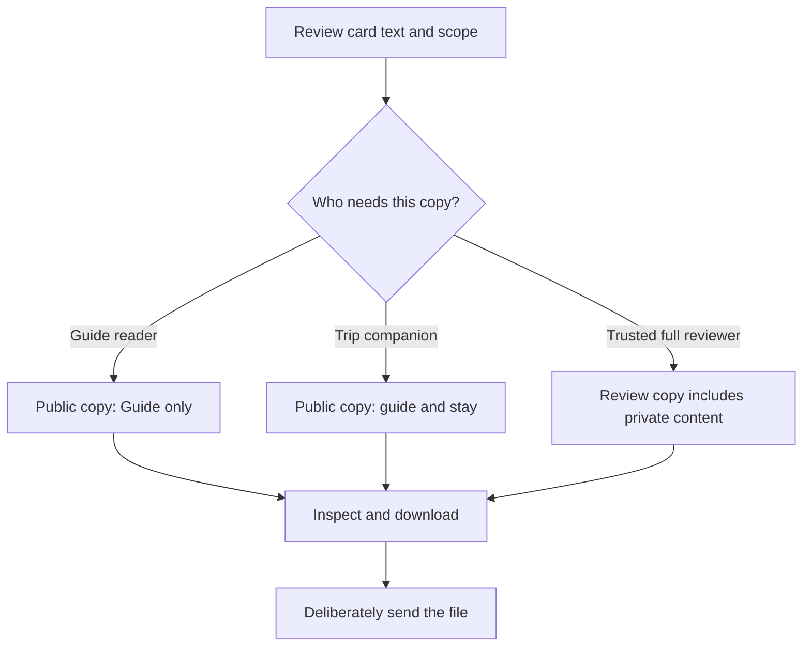

# Share the trip while choosing what stays private

Sharing a holiday plan should be a choice about specific material. Friends may need the itinerary and city guide; they may have no reason to receive your private notes, family photos or stay details. MoT gives you separate copy scopes so you can review that choice before a file leaves your browser.

Start by marking material for its intended audience. Guide cards support reusable local information, stay material belongs to the visit, and private material is for you. Think about the words inside a shared card as well as its label. A private access code pasted into shared text will still be shared text.

In Export, Public copy excludes private cards, private layers and their exclusive images. It can include guide and shared stay content. Choose Guide only when that narrower collection is enough. Review copy includes private notes, votes and images and is intended for a trusted person who needs the whole plan. “Public copy” describes the file's selection; exporting it does not itself publish it to a public website.

Check the preview and inclusion information, then download the file. Open it before sending it through your chosen channel. A reading copy and an editable package serve different purposes, so give the recipient the format they need. Keep a separate owner backup if you need all the original material for yourself.

For help from your own Muse conversation, select non-private cards in the file-handoff workflow and inspect the exact context. That context is different from a full Review copy: it excludes image bytes, credentials and whole-board history. You deliberately upload it, then review returned proposals locally.

Success is a recipient who gets enough information and an owner who understands what left the workspace. Downloaded copies cannot be recalled by changing a board later. Cloud-browser and assistant-provider storage follow their own environments and policies; a scope filter is not a blanket privacy guarantee.

## User journey map

| Moment | Owner's need | Action | Useful result |
| --- | --- | --- | --- |
| Prepare | Separate audiences | Review card scope and actual text | Intentional source material |
| Select | Match the recipient | Choose Public, Guide only or Review | An explicit copy scope |
| Inspect | Catch unwanted inclusion | Read preview and included material | A reviewed file |
| Send | Use the right channel and format | Deliberately hand over the download | A bounded snapshot |
| Continue | Understand retained copies | Keep a backup; export revisions separately | Clear ownership of versions |

[Documentation index](../INDEX.md) · [Data ownership philosophy](../philosophy/your-data-your-workspace.md)
