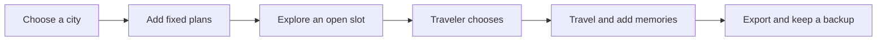

# Solo traveler: make room for the trip you want

A solo trip should leave you free to explore without making you remember every detail. Ministry of Tourism gives your bookings, saved places, photos and notes one visible home. You can build it yourself or ask Muse to help, then keep the decisions that make the trip yours.

Start with what you know. Choose a destination and add the few things that are fixed: an arrival, a place to stay, a meeting or a departure. Leave an unplanned afternoon as an unplanned afternoon. A useful board can be small; it does not need an activity for every hour.

Ask for help with a specific gap. For a fictional Bangkok weekend, you might say, “Suggest a quiet afternoon near my hotel, with time to rest.” Muse can propose options around the facts you supply. An idea remains an idea until you choose it. A saved card does not establish current opening hours, availability or a confirmed booking.

Keep the trip useful as it changes. Add a note after a good meal, move an optional stop when you feel tired, and keep your original photos. Today can help you see the next saved activity. Changes to a flight or hotel require your attention; a suggestion never cancels or purchases anything for you.

Take the trip away in the form you need. An HTML magazine is for reading, a PDF is convenient to send, and an editable ZIP lets you continue in MoT. Check the copy scope before downloading. Browser storage belongs to the browser profile you used, so keep an exported backup somewhere you control.

Success is a trip you can understand at a glance, with enough structure to feel prepared and enough space to change your mind.

## User journey map

| Moment | Traveler's need | Action | Useful result |
| --- | --- | --- | --- |
| Begin | Stop losing plans | Choose a city; add fixed facts | A small, readable board |
| Explore | Find something that fits | Ask Muse about one open slot | Tentative options with sources |
| Decide | Keep control | Keep, edit or remove suggestions | A plan that reflects personal pace |
| Travel | Remember the day | Add photos and short notes | Memories attached to the trip |
| Keep | Avoid losing the work | Preview and export | Reading copy and editable backup |

**Available path:** browser board, manual edits, browser-agent assistance and file exports. Live travel facts depend on their sources.

[Documentation index](../INDEX.md) · [Owner's manual](../OWNER-MANUAL.md)
