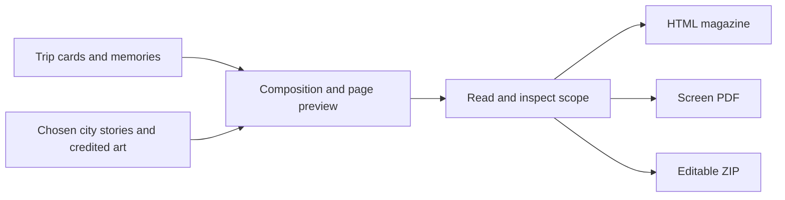

# Travel magazine: make the plan worth keeping

A trip deserves a better home than a pile of tabs. MoT turns the material you already collected into magazine pages: an itinerary, personal photos and notes, city stories and credited artwork. The result can help you anticipate the trip, enjoy it as it happens and remember it afterward.

Begin with the board rather than a blank page. Add the plans and memories you want represented, then explore FCC content for the selected city. Bring in the stories or artwork that help explain the place. Catalogue previews are reference material until you deliberately add them; viewing an image does not automatically make it part of your issue.

Shape the visual story in Composition. Place and crop artwork, arrange the material and preview the pages in Keepsakes. Curated images give the issue a consistent starting point, but your choices still matter. Check that a decorative image belongs to the city or is clearly presented with its original place and credit.

Read the issue as a future recipient. Confirm the dates, names and unscheduled ideas. Look for missing images or clipped text. Check the export selection and audience: Public copy omits private cards and their media, while Review copy includes private content. A visually polished page is still worth reading for mistakes before you send it.

Choose the format around the next use. Standalone HTML is for browser reading, including offline reading once downloaded. PDF is a lighter screen-oriented copy for sending. The editable ZIP preserves board material and layout for reopening in MoT. A new board revision needs a new export if you want the file to contain it.

Success is one collection of trip material serving several moments in your life. You can plan with it today and keep it later, without asking an agent to generate the whole holiday again.

## User journey map

| Moment | Reader's need | Action | Useful result |
| --- | --- | --- | --- |
| Collect | Use existing trip work | Add plans, photos and notes | Source material for the issue |
| Enrich | Give the trip a sense of place | Add relevant credited FCC assets | Editorial context |
| Compose | Make pages feel personal | Arrange and crop artwork | A visible design |
| Inspect | Trust the finished copy | Read dates, selection and private scope | A considered issue |
| Export | Match the next use | Choose HTML, PDF or ZIP | Reading, sharing or continued editing |

[Documentation index](../INDEX.md) · [Why reuse visual assets](../philosophy/visual-assets-before-generation.md)
